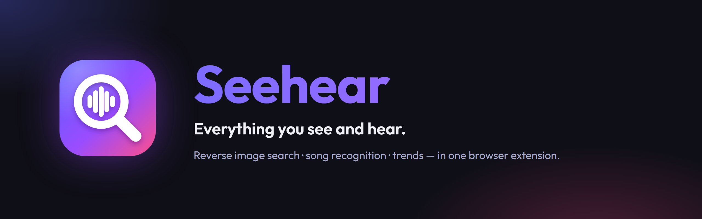
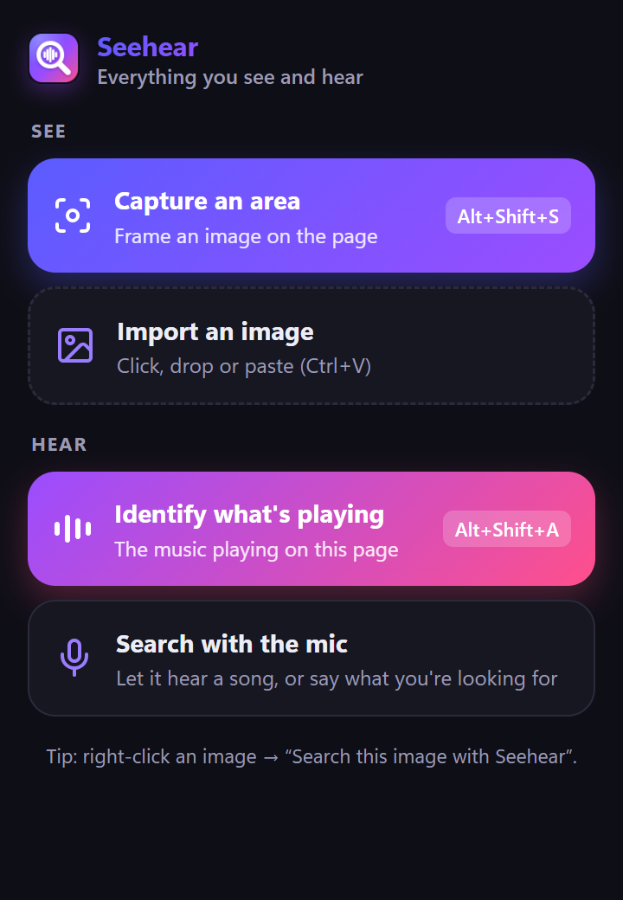
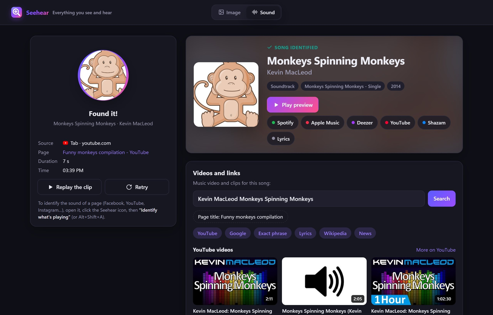
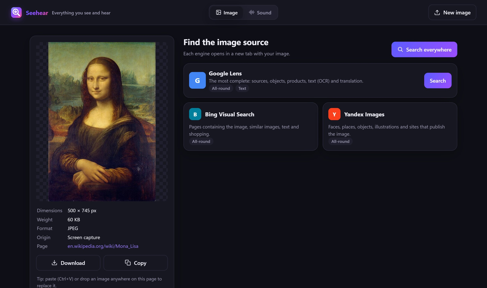

  

A Chrome / Edge extension that identifies what's on your screen and what's playing in your tab.

## Features

- **Reverse image search**: capture an area of a page, import, paste or right-click an image, then search it with Google Lens, Bing and Yandex.
- **Song recognition**: identify the music playing in a tab (no microphone needed) or around you with the mic, with lyrics, a preview and links to Spotify, Apple Music, Deezer, YouTube Music and Shazam.
- **Voice search**: say what you're looking for.
- **Trends**: popular Shorts, new videos and links to TikTok, Instagram and Facebook for any identified song.

<table>
  <tr>
    <td width="30%" valign="top"></td>
    <td width="70%" valign="top"></td>
  </tr>
</table>

More screenshots in [docs/screenshots](docs/screenshots).

## Install

Requires Chrome or Edge 116+. There is no build step.

1. Open `chrome://extensions` (or `edge://extensions`) and turn on **Developer mode**.
2. Click **Load unpacked** and select this folder.

## Usage

| Action | How |
| --- | --- |
| Search an image on a page | `Alt+Shift+S`, then drag around it |
| Search any image | Right-click it → **Search this image with Seehear** |
| Identify the song in a tab | `Alt+Shift+A` (press again to stop early) |
| Identify a song around you / voice search | Icon → **Search with the mic** |

## Privacy

Nothing is saved: images and audio clips stay in session memory and are erased when the browser closes. Only an audio fingerprint is sent to Shazam, never the audio itself. The recognized title and artist are then sent to Deezer and LRCLIB to add the preview, cover and lyrics. Voice transcription uses the browser's speech recognition (Google or Microsoft servers).

## Notes

- Built on unofficial endpoints (Google Lens, Bing, Yandex, YouTube, Shazam), each isolated in one file under `lib/` so it can be fixed if a service changes.
- Song fingerprinting is a port of [SongRec](https://github.com/marin-m/SongRec) (GPL-3.0).
- Song details come from the public [Deezer](https://developers.deezer.com/api) and [LRCLIB](https://lrclib.net) APIs (exact track by ISRC, preview, cover, lyrics).
- Screenshots use *Mona Lisa* (public domain) and *Monkeys Spinning Monkeys* by Kevin MacLeod ([CC BY 4.0](https://creativecommons.org/licenses/by/4.0/)).
- Seehear is not affiliated with or endorsed by Google, Microsoft, Yandex, Shazam, Apple, Deezer, Spotify, TikTok, Instagram or Facebook. All trademarks belong to their owners.

## License

[GPL-3.0](LICENSE), as required by the SongRec code it is derived from.
